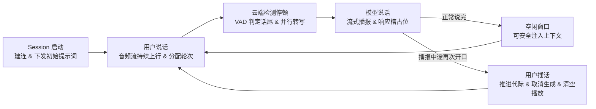
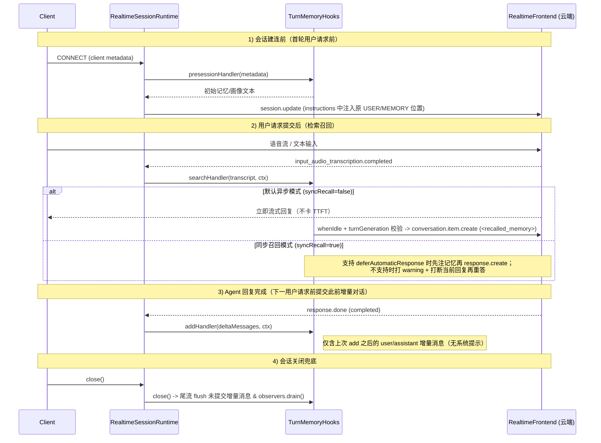

# 先进记忆系统与轮次记忆 Hook（TurnMemoryHooks）架构与设计

本文档介绍实时语音网关的双工交互约束、原有记忆系统及其屏蔽处理，以及三段式轮次记忆钩子（`presessionHandler`、`addHandler`、`searchHandler`）的整体设计逻辑。

> **相关文档**：具体实现逻辑、同步召回变体、接入指南与接口协议表请见 [先进记忆系统具体实现与接入指南](./advanced-memory-hooks-implementation.zh.md)。

---

## 1. 实时语音双工交互

### 1.1 实时语音双工交互核心逻辑

在 `qwen-audio-agent` 的三层架构中，实时语音对话由云端实时语音模型通过 WebSocket 长连接驱动；本地则负责把客户端的音视频/文本输入、云端语音活动检测（VAD）、工具调用与音频回放编排进同一套轮次生命周期里（核心编排见 [realtime-session-runtime.mjs](../../server/src/voice/realtime-session-runtime.mjs)）。

#### 1. 实时交互的轮次生命周期

一次典型的双工语音对话会经历「**Session 启动 → 用户说话 → 云端检测停顿 → 模型说话 → 用户插话 → 模型再次说话**」的连续流转：

1. **Session 启动（建连与初始化）**：客户端接入并上报环境信息后，本地网关向云端实时模型建立长连接，一次性下发系统提示词、可用工具与语音检测配置（连接管理见 [realtime-provider-session.mjs](../../server/src/voice/realtime-provider-session.mjs)，协议适配见 [realtime-provider.mjs](../../server/src/voice/realtime-provider.mjs)）；若是恢复已有会话，还会把近期对话作为衔接上下文写入，随后进入空闲监听态。整场会话中系统提示词保持稳定，以维持云端的前缀缓存（KV Cache）。
2. **用户说话（开口检测与流式采集）**：客户端持续向上游推送音频流。云端语音活动检测捕捉到人声起音后通知本地网关，网关为本轮分配新的轮次标识与单调递增的轮次代际，并将交互状态切为“聆听中”（输入流转见 [realtime-input-runtime.mjs](../../server/src/voice/realtime-input-runtime.mjs)，代际状态机见 [realtime-turn-state.mjs](../../server/src/voice/realtime-turn-state.mjs)）。
3. **云端检测停顿（话尾判定与并发转写）**：用户说完出现停顿后，云端判定话尾结束并切入处理态。默认服务端 VAD 模式下，云端无需等待本地指令便会**立刻开始生成回复**；与此同时，用户语音的最终转写文本异步回传并写入对话记录——也就是说，网关拿到完整用户文本时，云端往往已经开始输出首字音频。
4. **模型说话（流式生成、回放与响应槽占位）**：云端流式下发音频分片与助手字幕，本地网关转发给客户端播放并维护播放窗口（呈递与回放见 [realtime-presentation-runtime.mjs](../../server/src/voice/realtime-presentation-runtime.mjs)）。在生成期间，会话的响应槽处于占用态（见 [realtime-response-slot.mjs](../../server/src/voice/realtime-response-slot.mjs)），非紧急的上下文补充需要排队等待模型说完、响应槽释放后的空闲窗口。如果模型触发了工具调用，则会在工具返回后再续写最终回答。
5. **用户插话（抢断、代际推进与清理）**：若模型还在生成或播放时用户再次开口（或客户端触发打断），网关会立刻执行三件事：推进当前轮次代际以使上一轮仍在途的异步任务失效；通知云端取消尚未完成的生成（全双工播报模型仅停播不取消后台任务）；指示客户端立刻清空本地尚未播出的音频缓冲，重新回到“聆听中”。
6. **模型再次说话（新一轮接管）**：用户插话结束、云端再次检测到停顿后，模型基于最新对话上下文直接生成新一轮回复，进入下一次双工循环。

#### 2. 实时交互和文本模型轮次交互节点的对照

与传统的“客户端发一句 → 服务端组装上下文 → 调一次模型 → 返回一句”的文本模型相比，实时语音双工交互在每个关键节点上都有本质差异，这也直接决定了记忆钩子的挂载位置与安全策略：

| 交互节点 | 传统文本模型（请求-响应） | 实时语音双工模型（流式长连接） | 对记忆钩子设计的要求 |
| :--- | :--- | :--- | :--- |
| **会话初始化** | 每次请求无状态地重新拼装系统提示词与历史消息列表 | 建连时一次性下发系统提示词并常驻云端；中途改写会使整场前缀缓存失效 | 长期稳定画像须在建连前由 `presessionHandler` 一次性注入，对话中途不再改写系统提示词 |
| **用户输入到达** | 一次性收到完整文本，拿到全文后才进入后续流程 | 音频持续流式上行；停顿判定往往早于或并发于最终转写文本到达 | 记忆检索只能挂在“最终转写完成”节点，而非开口或停顿节点 |
| **模型开始生成** | 完全由本地在“检索完成 + 拼装完毕”后主动发起请求 | 默认服务端 VAD 下云端停顿即自动开答，本地默认不阻塞首字延迟 | 同步记忆召回会提升首字延迟或打断即时回话 |
| **上下文注入时机** | 同步插入本次请求的消息数组，不存在并发抢占 | 需避开用户正在说话与模型正在生成的响应槽占用期 | 牺牲体验直接打断会话。或者牺牲生成正确性，在安全空闲窗口追加上下文条目 |
| **用户中途插话** | 仅中断单次流式响应，下一轮是全新的独立请求 | 随时在生成/播放中途抢断，旧轮次的转写、检索、工具回调与播放回执可能滞后到达 | 必须处理异步结果，并在插话/打断时立即通过取消信号中止在途检索 |
| **回复完成与记忆落盘** | 流结束即意味着本轮完整交付，可直接写入记忆 | 生成完成不等于实际说完（存在工具续写中间态、待播放字幕缓冲、延迟最终字幕及被插话截断） | `addHandler` 需跳过失败/取消/工具中间态、对齐延迟落盘的助手文本，并在会话关闭时补做尾流 flush 兜底 |

---

## 2. `presession`、`add` 与 `search` Hook 的设计逻辑

整套记忆钩子按一次会话的三个关键时间锚点拆分为三个职责单一的 handler，均由每连接独占的 `TurnMemoryHooks` 实例承载：

### 2.1 `presessionHandler`：会话建连前注入稳定背景
- **时机**：客户端发送 `CONNECT`（或首次触发 `ensureFrontend`）之后、云端 `session.update` 发送之前，每个 session 仅调用一次（Promise 去重并缓存结果，断线重连复用同一前缀）。
- **设计目的**：把用户长期稳定画像/背景一次性放进 `instructions` 里原本 `USER.md` & `MEMORY.md` 所在的精确位置，整场会话不改 `instructions`，最大化云端 KV 前缀缓存命中率。

### 2.2 `addHandler`：下一用户请求前提交此前增量对话
- **时机**：每次 Agent 完成有效回复后立即触发（把本轮及此前尚未提交的 `user` / `assistant` 增量对话写入外部记忆），并在 `session.close()` 时补做一次尾流 flush，兜底用户说完未等答完就断开、最后一句取消/失败、或后台任务结果未播报就关闭的遗留消息。
- **关键约束**：
  - 独立维护会话内 `lastAddedSeq` 水位（初始化跳过从 `SessionJournal` 恢复的历史记录，也不受旧记忆 `discardRecorded` 影响）；
  - 经过 `projectFrontendConversation` 投影并限定 `role ∈ {'user', 'assistant'}`，**严格排除系统提示词及 `<recalled_memory>` 等注入上下文**；
  - 同一会话的多次 `addHandler` 经 `addQueue` 严格串行，避免乱序写库；挂入 `observers.track()` 以便 `frontendRuntime.close()` 时 `drain()` 等落盘。

### 2.3 `searchHandler`：用户请求提交后检索并安全回注
- **时机**：用户语音转写完成（`conversation.item.input_audio_transcription.completed`）或手动文本提交（`TEXT_MESSAGE` / `INPUT_MESSAGE`）后触发。
- **两种回注策略**：
  1. **默认异步安全插话（推荐，`syncRecall: false`）**：不阻塞当前轮云端自动回复（零首字延迟增加）；检索返回后先校验 `turns.committedTurnGeneration` 与 `turns.turnGeneration` 未过期且未处于说话状态，再通过 `RealtimeFrontend` 的 `enqueueAction` → `whenIdle()` 等待响应槽空闲并二次校验，最后以 `conversation.item.create` 写入 `<recalled_memory>` 供后续轮次参考。
  2. **同步召回变体（`syncRecall: true`）**：希望本轮回答立即用到召回记忆时开启。若 Provider 支持阻止自动回复，则等 `searchHandler` 返回后再触发回复；若云端不支持，则在记忆返回后打 warning 并打断当前无记忆回复、注入记忆后重新生成。

## 3 原有记忆系统的处理

### 3.1 原有内置记忆系统简介

框架原有的内置记忆系统（位于 [server/src/memory/](../../server/src/memory/module.mjs)）以静态文档和会话结束后的离线整理为核心，支持本地 Markdown 文件（`USER.md` 存用户偏好、`MEMORY.md` 存长期记忆）与 VoiceMem 外部进程两种后端：

- **记忆读取方式**：
  1. 会话建连时，网关会把这两份记忆文档拼接进系统提示词中，随会话初始化一次性发给模型（拼接逻辑见 [context.mjs](../../server/src/memory/context.mjs) 与 [frontend-tools.mjs](../../server/src/frontend/frontend-tools.mjs)）；
  2. 对话过程中，模型也可以按需调用内置的记忆工具主动查阅或修改文档（工具定义见 [tools.mjs](../../server/src/memory/tools.mjs)）。
- **记忆写入方式**：
  1. 模型在对话中显式调用内置记忆工具写入；
  2. 会话关闭时，由会话观察器在后台触发一次轻量大模型的自动记忆抽取，并在开启对应开关时进行跨会话的用户偏好观察与晋升（生命周期编排见 [session-observer.mjs](../../server/src/memory/session-observer.mjs)）。
- **独立的会话摘要能力**：
  - 除长期记忆外，网关还提供可选的会话摘要功能：在每次会话结束时提炼话题要点落盘，供模型后续通过回忆工具查询“前几天聊过什么”（实现见 [session-summariser.mjs](../../server/src/conversation/session-summariser.mjs)）。

### 3.2 先进记忆开关与旧系统屏蔽处理

为了支持外部自定义记忆系统独立接管记忆的读写与召回，同时避免两套记忆同时生效造成提示词冲突或重复写入，网关引入了总开关 `QWEN_AUDIO_ADVANCED_MEMORY`（配置解析见 [config.mjs](../../server/src/core/config.mjs)，装配逻辑见 [gateway-application.mjs](../../server/src/app/gateway-application.mjs)）：

- **开启先进记忆（`on`）时**：
  - **屏蔽原有记忆模块**：记忆模块初始化阶段会直接短路为空状态（见 [memory/module.mjs](../../server/src/memory/module.mjs)）——不再初始化本地 Markdown 或 VoiceMem 存储，不再向系统提示词注入 `USER.md` / `MEMORY.md`，不再向模型暴露内置记忆工具，不再注册会话关闭时的自动抽取与偏好学习，原记忆管理接口也返回未配置状态。
  - **屏蔽原有会话摘要**：同步跳过会话摘要器与摘要池的初始化，不再暴露旧的回忆工具。
  - **激活轮次记忆钩子**：自动加载先进记忆入口文件（见 [advanced-memory.mjs](../../server/src/memory/advanced-memory.mjs)）或嵌入方显式传入的处理函数，由轮次记忆钩子接管全流程。
  - **覆写告警提示**：启动时会检查哪些原有记忆配置仍处于开启/生效状态，并输出一条 `memory.legacy_overridden` 警告日志，明确告知这些旧配置已被先进记忆开关覆写并关闭。
- **关闭先进记忆（默认 `off`）时**：
  - 原有记忆系统与会话摘要按原有逻辑完整运行，轮次记忆钩子不会生效，也不会产生覆写告警。

---

## 下一步阅读

- 具体实现代码解析、同步召回变体、接入示例与完整协议表：[advanced-memory-hooks-implementation.zh.md](./advanced-memory-hooks-implementation.zh.md)
